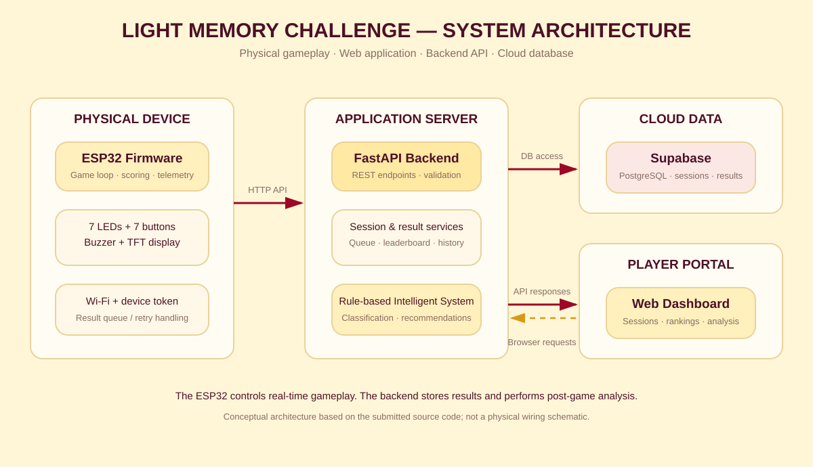
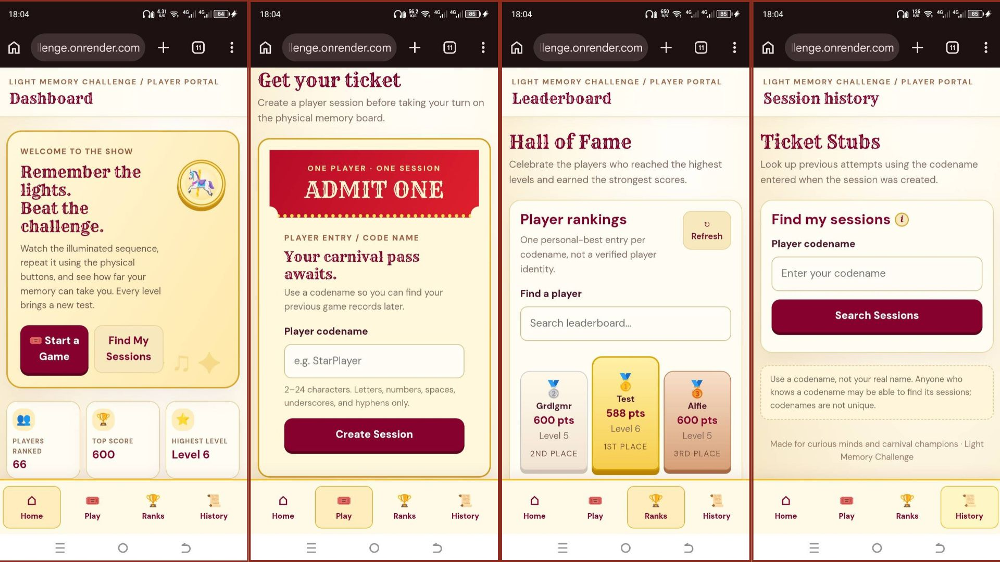

<div align="center">

# LIGHT MEMORY CHALLENGE

### Remember the lights. Beat the challenge.

**An ESP32-powered interactive memory game with a web-based player portal and rule-based performance analysis.**

`ESP32` · `FastAPI` · `Supabase` · `HTML/CSS/JavaScript` · `Render`

</div>

---

## 1. Project Overview

Light Memory Challenge (LMC) is an interactive memory game that combines a physical ESP32 game board with a browser-based player portal. Players create a session through the web dashboard, follow light sequences on the physical board, and receive game results and performance feedback through the web application.

## 2. Project Demo

Watch the demonstration of Light Memory Challenge to see its physical gameplay, web-based interface, and implemented Intelligent System features.

**[▶ Watch the System Demonstration on YouTube](https://www.youtube.com/watch?v=sBiUq99xk_M)**

**[🌐 Open the Live Web Application](https://light-memory-challenge.onrender.com)**

The video demonstrates the user-facing experience and selected system features. For the complete implementation details, hardware documentation, system architecture, and testing information, refer to the [Technical Documentation](docs/TECHNICAL_DOCUMENTATION.md).

## 3. System Design



The ESP32 handles real-time gameplay and local difficulty changes. The FastAPI backend manages sessions, receives results, stores records in Supabase, and runs post-game performance analysis. The browser dashboard communicates with the backend through its API.

## 4. Hardware Setup

| Component | Role |
|---|---|
| ESP32 DevKit / ESP32-WROOM | Main controller and network connection |
| 7 LEDs | Display the generated sequence |
| 7 push buttons | Receive the player's sequence input |
| Physical abandon/reset button | Abandon the active session when held for 2 seconds |
| Buzzer | Audio feedback |
| 1.8-inch ST7735 SPI TFT | Countdown, gameplay status, and result display |
| External 10 kΩ pull-up resistors | Required for GPIO 34 and GPIO 35 button inputs |

See [Hardware Pin Assignments](docs/TECHNICAL_DOCUMENTATION.md#33-pin-assignments) for the complete GPIO mapping.

## 5. Software Architecture

| Layer | Technology | Responsibility |
|---|---|---|
| Firmware | Arduino C++ for ESP32 | Physical game, scoring, telemetry, device communication |
| Backend/API | Python, FastAPI, Uvicorn | Sessions, API endpoints, validation, database coordination |
| Intelligent System | Python rule-based analysis | Post-game classification and recommendations |
| Database | Supabase (PostgreSQL) | Persistent session and result records |
| Frontend | HTML, CSS, JavaScript | Player portal, leaderboard, session history, performance views |
| Hosting | Render | Hosts the deployed backend/web application |

## 6. Cloud and Dashboard Configuration

The application is deployed through a GitHub-connected Render service using the Free plan. Supabase provides persistent database storage. The dashboard includes system status, session creation and queue/start controls, leaderboard, codename-based session history, result details, and per-level performance analysis.

### Dashboard Preview



## 7. Testing Results

The uploaded project archive's automated test suite was executed during documentation preparation: **133 tests passed, 0 failures, 0 errors**. This is a snapshot result. The physical ESP32 prototype was tested without wiring issues, and the Render deployment was verified to be operational. See [Testing Record](docs/TECHNICAL_DOCUMENTATION.md#63-manual-test-record) for manual test rows.

## 8. Security and Privacy Notes

- Keep Supabase service-role credentials, Wi-Fi credentials, and the device API token out of source control.
- `.env` and `firmware/src/arduino_secrets.h` are excluded by `.gitignore`.
- Device requests use an `X-Device-Token` header.
- Use player codenames rather than real names. Codenames are not unique and should not be treated as verified identities.
- The current ESP32 HTTPS implementation calls `setInsecure()`, which skips server certificate verification. This is a known limitation and should be addressed before production use. The firmware also uses an offline result queue and persists a pending abandon target when delivery fails.
- Do not publish screenshots containing credentials, API keys, private dashboard information, or personal data.

## 9. Setup and Usage Instructions

See [Local Run Guide](RUNNING.md) and [Technical Documentation](docs/TECHNICAL_DOCUMENTATION.md) for complete backend, database, firmware, and player instructions. These guides provide the detailed setup and implementation reference for the project.

Quick backend setup (PowerShell):

```powershell
py -3.12 -m venv .venv
.\.venv\Scripts\Activate.ps1
pip install -r backend\requirements.txt
Copy-Item .env.example .env
python -m uvicorn backend.main:app --host 0.0.0.0 --port 8000
```

Configure the `.env` values and the local, untracked `firmware/src/arduino_secrets.h` before connecting the device. Never commit real credentials.

## Documentation

- [Technical Documentation](docs/TECHNICAL_DOCUMENTATION.md)
- [Deployment Guide](docs/DEPLOYMENT_GUIDE.md)
- [Local Run Guide](RUNNING.md)
- [Firmware Notes](firmware/README_Firmware.txt)

## Credits

Developed as an academic Internet of Things project for **COSC 111 – Internet of Things**, Cavite State University – Bacoor City Campus.

**Project team:**
`Claire Jersey I. Ferrer`
`Laurince C. Dugaduga`
`Elijah Azanti N. Ramirez`
`Kian T. Serantes`
`Mary Celynia Garcia`
`Renarld M. Detablan`

See [Team Contributions](docs/TEAM_CONTRIBUTIONS.md) for the detailed roles of each member.

---

<div align="center">

*Light Memory Challenge — Remember the lights. Beat the challenge.*

</div>