# LIGHT MEMORY CHALLENGE
## Technical Documentation

**Course:** COSC 111 – Internet of Things  
**Institution:** Cavite State University – Bacoor City Campus  
**Project:** Light Memory Challenge  

---

## 1. Project Overview

### 1.1 Problem Statement

Light Memory Challenge is designed to provide an interactive way to exercise and assess a player's short-term visual memory through a physical light-sequence game. A player observes a sequence displayed by LEDs and reproduces the sequence using corresponding physical buttons. The system records gameplay performance and makes the results available through a web-based portal.

### 1.2 Objectives

The project aims to:

1. Develop a physical memory game controlled by an ESP32 microcontroller.
2. Provide visual and audio feedback through LEDs, a TFT display, and a buzzer.
3. Connect the physical game board to a web application through a backend API.
4. Store player sessions and completed game results in a cloud database.
5. Provide a dashboard for session creation, session history, player rankings, and performance review.
6. Apply rule-based performance analysis to generate classifications and recommendations from recorded gameplay data.
7. Improve gameplay continuity through session queuing, offline result storage, and retry handling.

### 1.3 Intended Users

The intended users are students, demonstrators, and participants who interact with the physical memory game and its web portal. Players use a codename when creating a session. A codename is not a verified identity and is not guaranteed to be unique.

### 1.4 Scope

The current implementation includes a single configured ESP32 device, seven light/button pairs, a TFT display, a buzzer, browser-based session management, a FastAPI backend, Supabase persistence, a leaderboard, session history, and rule-based post-game performance analysis. The firmware also implements in-game difficulty reduction after repeated mistakes at the same level.

The current project does not establish verified player identities. The Intelligent System is rule-based and should not be described as a trained machine-learning model.

## 2. System Design

### 2.1 System Architecture

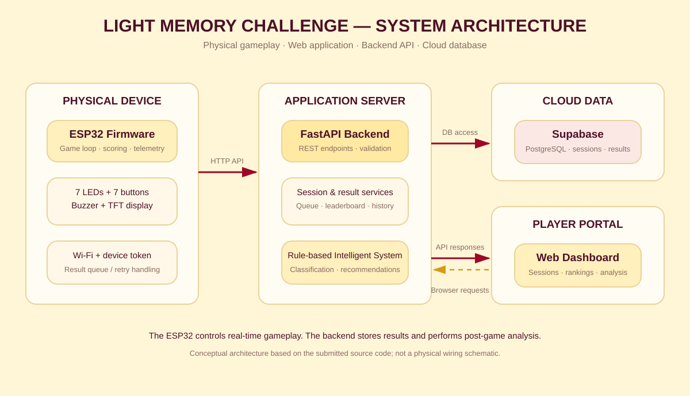

The system consists of four main parts:

1. **Physical device layer:** The ESP32 controls the LEDs, gameplay buttons, abandon/reset button, buzzer, and TFT display. It handles sequence generation, player input, scoring, timing, and immediate in-game difficulty changes.
2. **Application layer:** The web dashboard is served by the FastAPI backend. It allows players to create sessions, start their turn, view rankings, and retrieve session history and analysis.
3. **Communication layer:** The ESP32 communicates with the backend using HTTP requests. The firmware uses an `X-Device-Token` header for device authentication. The browser communicates with the backend through its `/api` endpoints.
4. **Cloud/data layer:** The backend stores session and result records in Supabase (PostgreSQL). The backend also runs the post-game Intelligent System and returns analysis to the dashboard.

### 2.2 Main Components

| Component | Technology / Module | Responsibility |
|---|---|---|
| Microcontroller | ESP32 DevKit / ESP32-WROOM | Controls game hardware and communicates with backend |
| Light indicators | 7 LEDs | Displays the generated sequence |
| Player input | 7 push buttons | Captures the player's sequence response |
| Physical control | Abandon/reset button | Abandons an active session when held for two seconds |
| Audio output | Buzzer | Provides game sound feedback |
| Display | 1.8-inch ST7735 SPI TFT | Displays countdown, game status, and result information |
| Firmware | `LightMemoryChallenge.ino` | Implements the physical game and device communication |
| Backend | FastAPI (`backend/main.py`) | Exposes API endpoints and coordinates session/result operations |
| Intelligent System | `backend/intelligent_system.py` | Classifies performance and generates recommendations |
| Data access | `backend/data_access.py` | Handles database-backed session, result, and ranking operations |
| Reliability layer | `backend/reliability.py` | Handles database health checks and retry/error classification |
| Telemetry processing | `backend/telemetry.py`, `backend/difficulty_events.py` | Normalizes game telemetry and validates difficulty events |
| Database | Supabase / PostgreSQL | Persists sessions and game results |
| Frontend | `web/index.html` | Provides the browser-based player portal |
| Hosting | Render | Hosts the deployed backend/web application |

### 2.3 Data Flow

1. A player opens the web dashboard and enters a codename to create a session.
2. The browser sends a session-creation request to the FastAPI backend.
3. The backend creates a waiting session in Supabase and returns the session information to the browser.
4. The player starts the session from the website. The backend schedules the start and exposes a start command for the configured ESP32 device.
5. While idle, the ESP32 polls the backend for a device command. When a start command is received, the ESP32 confirms the session start and displays the countdown.
6. The ESP32 generates and displays a sequence through the LEDs. The player repeats the sequence using the seven physical buttons.
7. The firmware records score, lives, levels, response times, mistakes, per-level telemetry, and difficulty events.
8. When the game ends, the firmware stores the result payload in ESP32 flash before attempting delivery. It sends the result to the backend and retains/retries it when a temporary delivery failure occurs.
9. The backend validates and normalizes the payload, stores the result in Supabase, and runs the post-game Intelligent System analysis.
10. The browser retrieves the result and displays performance information. The leaderboard is updated from completed results.

### 2.4 Game Rules and Difficulty Behavior

The firmware defines a maximum of 20 levels and starts the player with three lives. A mistake or timeout costs one life. Two failed sequences on the same level reduce the current level by exactly one (Level 1 is the floor); a successful sequence resets the same-level mistake counter. After losing a life, the next sequence playback receives a one-attempt LED viewing-time bonus of +120 ms. The firmware uses a 15-second base response allowance at Level 1, adds 1 second per level up to a 30-second base cap, and adds a 5-second grace period. Scoring awards 100 points within a full-score window of 5 seconds at Level 1, increasing by 1 second per level; points then decrease linearly to zero at the response deadline. Timeout earns zero. These rules are implemented in the firmware; see `SCORING_CHANGELOG.txt` in the source repository for the scoring explanation.

The physical abandon/reset button is GPIO 15. It is not a game-start button. A staff can use it to abandon a targeted session by holding it for two seconds; the device can target the active countdown/game or the oldest waiting session while idle. The website is responsible for session creation and starting a queued session, as well as the abandon mechanic for players. The physical button is only for emergency if a player leaves the queue without notice. The current firmware countdown is a local four-to-one countdown followed by GO.

### 2.5 Communication and Cloud Services

| Connection | Method | Purpose |
|---|---|---|
| Browser → FastAPI | HTTP API requests | Session creation, starting, status, history, leaderboard, and result retrieval |
| ESP32 → FastAPI | HTTP requests | Polling for commands, confirming start, submitting results, and abandoning a session |
| FastAPI → Supabase | Supabase Python client / PostgreSQL API | Persistent session and result storage |
| Browser → hosted application | HTTPS when accessed through the deployed Render URL | Remote access to the web portal |

The firmware selects its backend base URL through `SECRET_API_BASE_URL`. The local development example uses an address such as `http://192.168.1.100:8000`; the deployed device configuration should use the actual hosted backend URL.

## 3. Hardware Setup

### 3.1 Hardware Components

| Hardware | Quantity | Purpose |
|---|---:|---|
| ESP32 DevKit / ESP32-WROOM | 1 | Main controller |
| LEDs | 7 | Sequence output |
| Push buttons for gameplay | 7 | Player input |
| Abandon/reset push button | 1 | Physical session abandonment |
| Buzzer | 1 | Audio feedback |
| 1.8-inch ST7735 SPI TFT display | 1 | Visual interface |
| External 10 kΩ pull-up resistors | 2 | Required for GPIO 34 and GPIO 35 button inputs |
| Breadboard / jumper wires / suitable power source | As required | Circuit assembly and power |

**Important:** The GPIO 34 and GPIO 35 inputs are input-only and do not provide internal pull-ups. The firmware documentation specifies an external 10 kΩ pull-up resistor from each of these GPIO pins to 3.3 V; each corresponding button connects its GPIO to GND when pressed.

### 3.2 Hardware Evidence

The physical ESP32 prototype has been assembled and tested, with no wiring-related problems observed during its testing.

- **Overall prototype:** 

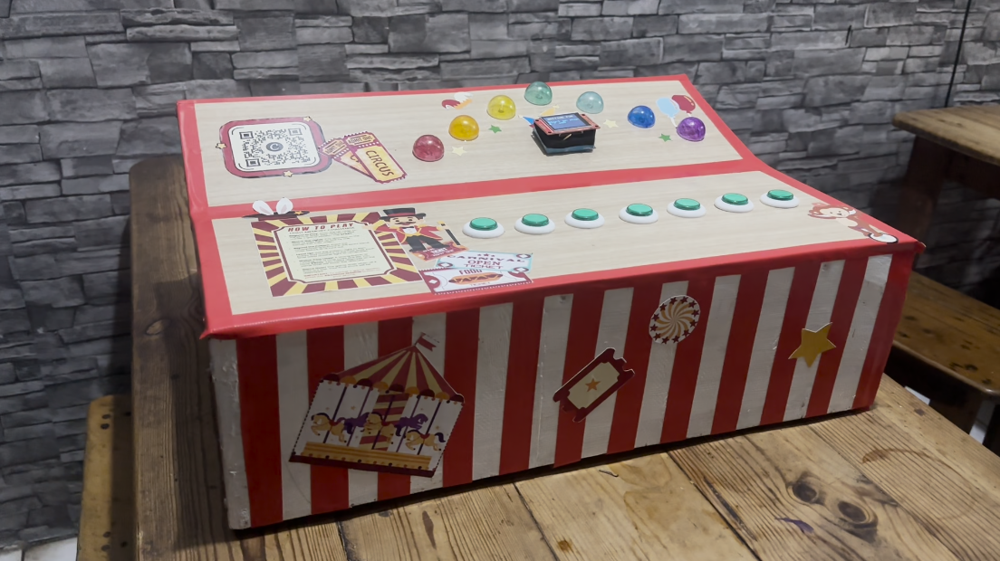
- **Hardware Interconnection Diagram**: 

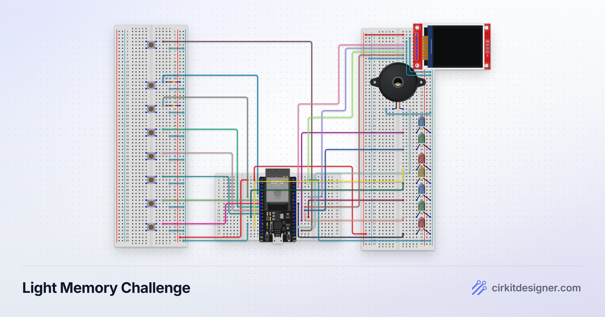
- **ESP32 and wiring close-up:** 

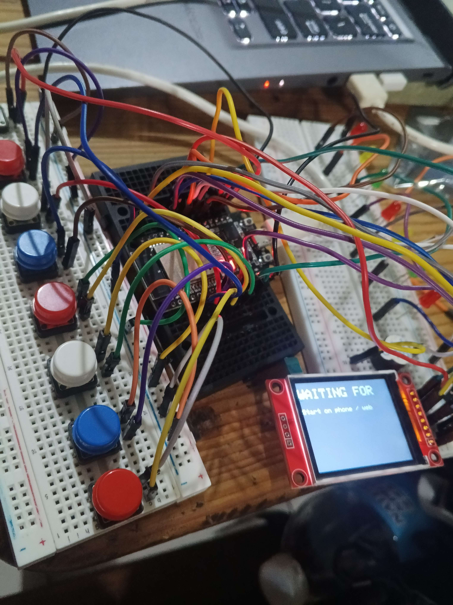
- **TFT during gameplay:** 

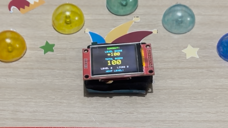
- **LED and Button board:** 

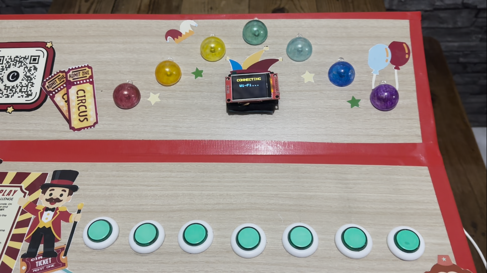

### 3.3 Pin Assignments

| Device component | ESP32 GPIO | Notes |
|---|---:|---|
| LED 1 | 4 | LED output |
| LED 2 | 5 | LED output |
| LED 3 | 13 | LED output |
| LED 4 | 14 | LED output |
| LED 5 | 16 | LED output |
| LED 6 | 17 | LED output |
| LED 7 | 19 | LED output |
| Gameplay button 1 | 34 | Input-only; external 10 kΩ pull-up required |
| Gameplay button 2 | 35 | Input-only; external 10 kΩ pull-up required |
| Gameplay button 3 | 25 | Gameplay input |
| Gameplay button 4 | 26 | Gameplay input |
| Gameplay button 5 | 27 | Gameplay input |
| Gameplay button 6 | 32 | Gameplay input |
| Gameplay button 7 | 33 | Gameplay input |
| Abandon/reset button | 15 | Hold for 2 seconds |
| Buzzer | 2 | Audio output |
| TFT SCK | 18 | SPI clock |
| TFT MOSI | 23 | SPI data output |
| TFT DC | 21 | Data/command |
| TFT RST | 22 | Reset |
| TFT CS | GND / no GPIO | Firmware configures hardware SPI with CS = -1 |

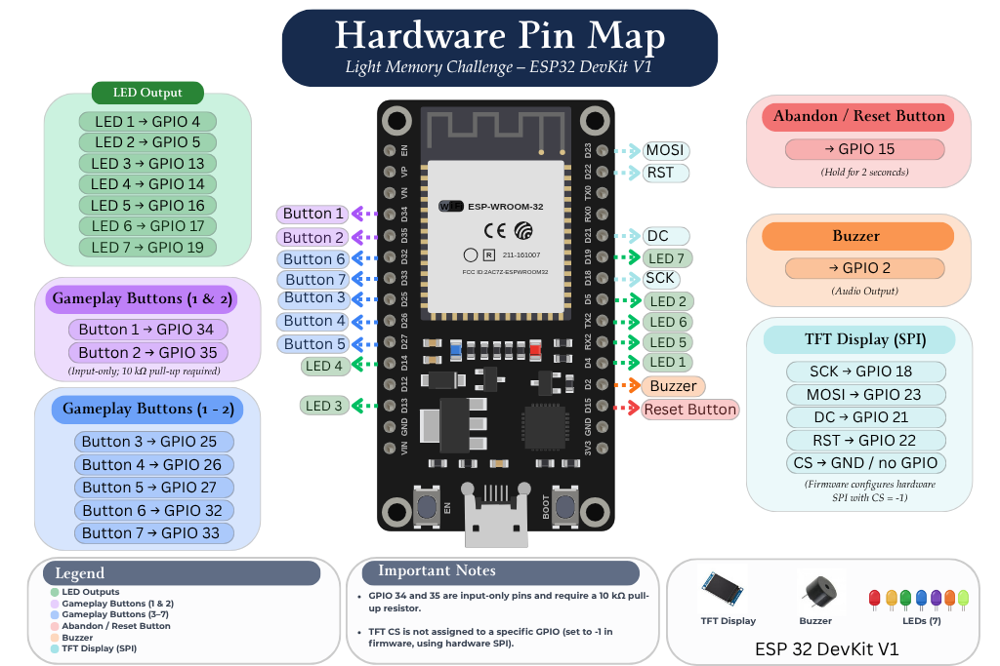

### 3.4 Hardware Setup Notes

- Confirm the ESP32 board variant and its pin behavior before rebuilding the circuit.
- GPIO 34 and GPIO 35 require the external pull-up arrangement described above.
- The TFT uses hardware SPI; MISO is disabled in the current firmware configuration so GPIO 19 remains available for the seventh LED.
- Use an appropriate power source for the complete assembly and verify the board remains stable during operation.
- The prototype was tested during the IoT exhibit; observed results are summarized in Section 6.3.

## 4. Software Architecture

### 4.1 Repository Code Structure

| File / Directory | Description |
|---|---|
| `backend/main.py` | FastAPI application, request models, API routes, device-token checks, and web page serving |
| `backend/intelligent_system.py` | Rule-based post-game performance classification and personalized insights |
| `backend/data_access.py` | Session creation, session search, result retrieval, and leaderboard data operations |
| `backend/difficulty_events.py` | Validation of firmware-reported in-game difficulty changes |
| `backend/reliability.py` | Database retry behavior, health checks, and error classification |
| `backend/telemetry.py` | Normalization of compact firmware telemetry into backend fields |
| `backend/requirements.txt` | Python dependencies |
| `firmware/src/LightMemoryChallenge.ino` | ESP32 game logic, display, input handling, scoring, telemetry, and API communication |
| `firmware/src/arduino_secrets.example.h` | Example device configuration; copy locally to `arduino_secrets.h` |
| `web/index.html` | Web dashboard structure, styling, and browser-side application logic |
| `database/schema.sql` | Supabase table, sequence, index, and row-level-security setup |
| `database/migrations/` | Database migration scripts |
| `tests/` | Automated unit and integration-oriented tests |

### 4.2 Backend Responsibilities

The FastAPI backend serves the web dashboard and exposes the API used by the browser and ESP32. Its main responsibilities include:

- Creating and managing player sessions.
- Scheduling session starts and exposing device commands.
- Receiving device start confirmations and abandon requests.
- Receiving and validating completed game results.
- Storing and retrieving session and result information through Supabase.
- Producing leaderboard and player-session search data.
- Running the Intelligent System analysis after a completed result is received.
- Reporting backend, database, and recent device-contact status through the health endpoint.

### 4.3 Main API Routes

| Method | Endpoint | Purpose |
|---|---|---|
| `GET` | `/` | Serves the web dashboard |
| `GET` | `/api/health` | Reports backend and database health and recent device contact information |
| `POST` | `/api/sessions` | Creates a player session |
| `POST` | `/api/sessions/{session_id}/start` | Requests the start of a session |
| `POST` | `/api/sessions/{session_id}/abandon` | Abandons a session through the web application |
| `POST` | `/api/device/abandon` | Receives an authenticated physical-device abandon request |
| `GET` | `/api/device/command` | Provides a pending command to the configured device |
| `POST` | `/api/device/started` | Confirms that the device started a session |
| `GET` | `/api/leaderboard` | Returns leaderboard entries |
| `GET` | `/api/players/search` | Searches sessions by codename |
| `GET` | `/api/sessions/{session_id}` | Retrieves session and result information |
| `POST` | `/api/sessions/{session_id}/results` | Receives a completed game result |

Device requests use the `X-Device-Token` header. Refer to the backend source for request schemas and validation rules.

### 4.4 Intelligent System

The Intelligent System is implemented as a **rule-based analysis module**, not a trained machine-learning model. It uses gameplay telemetry to classify performance and generate explanations and recommendations.

The analysis considers:

- Accuracy per level.
- Average response time per button press, derived from per-level sequence response time and sequence length.
- Failed-sequence rate.
- Incorrect button selections and their distribution.
- Incorrect input positions within a sequence.
- Performance trends and available previous-session history.

The latest level's performance is classified using accuracy, input pace, and mistake-rate bands. The implementation uses the following thresholds:

| Metric | Excellent | Good | Average | Struggling |
|---|---:|---:|---:|---:|
| Accuracy | ≥ 90% | ≥ 80% | ≥ 60% | < 60% |
| Time per button press | ≤ 1.0 s | ≤ 1.5 s | ≤ 2.5 s | > 2.5 s |
| Failed-sequence rate | ≤ 10% | ≤ 25% | ≤ 50% | > 50% |

The classification is based on accuracy, with a cap at Good unless all three metrics are Excellent. If both speed and mistake-rate bands are lower than the base classification, the classification is reduced by one band. A struggling metric prevents the post-game system from recommending an increase in difficulty.

The post-game analysis suggests a level for a future game; it does not change the level of the game that has already ended. The separate in-game two-mistake rule is implemented by the ESP32 firmware.

A single attempted sequence is sufficient for a provisional assessment and is marked low confidence; two or more attempts produce moderate confidence. There is no minimum of three sequences for classification. Insight-specific rules have their own evidence thresholds (for example, repeated-button and sequence-position patterns require multiple incorrect presses). The dashboard can show per-level classification/sufficiency and incorrect press details. Interpret recommendations in light of evidence volume.


**Post-game level suggestion rules (code implementation):**

| Classification | Suggested level adjustment |
|---|---|
| Excellent | +1; +2 only when accuracy is at least 95% and failed-sequence rate is at most 5% |
| Good | +1 unless speed or mistake-rate band is Struggling, in which case 0 |
| Average | 0 |
| Struggling | 0 when accuracy is at least 50%; −1 at 30–49%; −2 below 30% |

Any metric in the Struggling band blocks a positive adjustment. The suggested level is advice for the next game only; the website's new games start at Level 1.

Personalized insight rules also look for a button with repeated errors (minimum 3 incorrect presses, with the most-mistaken button accounting for at least 40% and at least 3 presses), error concentration in a sequence third (minimum 4 incorrect-position samples and a pattern threshold), accuracy decline at higher levels, rushed input when accuracy is low, input pace near the level deadline, and comparison with the previous completed session for the same codename. Confidence is marked provisional when evidence is limited. The exact phrasing and thresholds are maintained in `backend/intelligent_system.py`.

### 4.5 Database Design

The current SQL schema defines two main tables and a sequence for readable session numbers:

| Table | Purpose |
|---|---|
| `game_sessions` | Stores session ID, readable session number, codename, device ID, status, and timestamps |
| `game_results` | Stores score, highest level, mistakes, round counts, accuracy, duration, lives, response-time metrics, per-level telemetry, and Intelligent System analysis |

The `game_results.session_id` field references `game_sessions.id`. `game_sessions.session_number` is a unique, sequential readable identifier used to format labels such as `Session #001`. Per-level telemetry and analysis are stored in JSONB fields (`round_data` and `analysis`), including gameplay difficulty events. The schema enables row-level security on both tables. The backend accesses Supabase server-side with its service-role key. No separate migration is required for the current telemetry/event JSONB updates; the readable session-number migration is required for an existing database that has not yet received it.

## 5. Cloud and Dashboard Configuration

### 5.1 Cloud Services

| Service | Role | Configuration |
|---|---|---|
| Render | Hosts the deployed backend and web application | Team reports deployment from a GitHub repository using the Free plan |
| Supabase | Cloud PostgreSQL database | Configured through backend environment variables |
| GitHub | Source-code repository and deployment source | Connected to the deployment service |

**Live deployment URL:** https://light-memory-challenge.onrender.com  
**GitHub repository:** https://github.com/clairejerseyferrer/light-memory-challenge

### 5.2 Backend Environment Variables

The backend reads configuration from environment variables. For local development, copy `.env.example` to `.env` in the repository root.

| Variable | Required | Description |
|---|---|---|
| `SUPABASE_URL` | Yes | Supabase project URL |
| `SUPABASE_SERVICE_ROLE_KEY` | Yes | Private server-side Supabase service-role key |
| `DEVICE_API_TOKEN` | Yes for authenticated device operations | Shared token checked by the backend for device requests |
| `DEFAULT_DEVICE_ID` | No | Device identifier; defaults to `ESP32-001` |
| `DB_TIMEOUT_SECONDS` | No | Database request timeout; default 10 seconds |
| `DB_RETRY_ATTEMPTS` | No | Database retry setting; default 3 |
| `DB_RETRY_BASE_DELAY` | No | Base delay for retry backoff; default 0.25 seconds |
| `DB_RETRY_BUDGET_SECONDS` | No | Total retry time budget; default 12 seconds |
| `DB_PAGE_SIZE` | No | Database page size; default 1000 |
| `LOG_LEVEL` | No | Logging level; default `INFO` |

For Render, add the required environment variables in the service's Environment settings. Never place real values in this document or in screenshots.

### 5.3 ESP32 Configuration

The firmware reads its private configuration from `firmware/src/arduino_secrets.h`, created by copying `arduino_secrets.example.h`.

| Firmware setting | Description |
|---|---|
| `SECRET_SSID` | Wi-Fi network name |
| `SECRET_OPTIONAL_PASS` | Wi-Fi password |
| `SECRET_API_BASE_URL` | Local or deployed backend base URL, without a trailing slash |
| `SECRET_DEVICE_ID` | Device identifier; must match the backend configuration |
| `SECRET_DEVICE_TOKEN` | Must match `DEVICE_API_TOKEN` on the backend |

### 5.4 Dashboard Features

The web application includes:

- **Dashboard:** system status and quick navigation.
- **Start a Game:** player codename entry, session creation, queue/session status, and session start controls.
- **Leaderboard:** player rankings based on best qualifying entries per codename.
- **Session History:** search for sessions using a codename and open completed game results.
- **Performance Analysis:** game summary, per-level analysis, classifications, and personalized recommendations.

### 5.5 Dashboard Evidence

The following screenshots document the deployed web application, its main features, and the cloud services used by the system. These images provide visual evidence of the application's functionality and deployment configuration.

#### 5.5.1 Main Dashboard


*Figure 5.1. Main dashboard displaying the system interface.*

#### 5.5.2 Session Creation

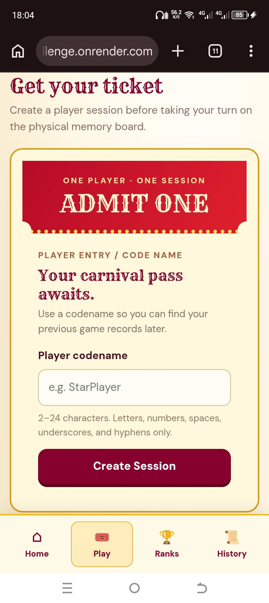

*Figure 5.2. Session creation interface where a player enters a codename and creates a game session.*

#### 5.5.3 Leaderboard

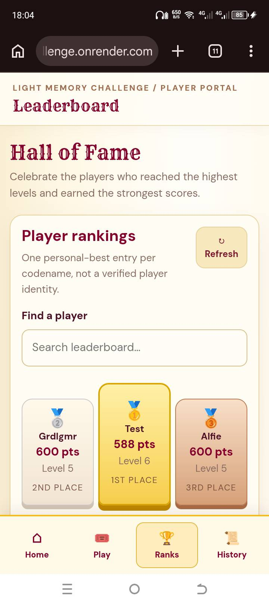

*Figure 5.3. Leaderboard displaying recorded player rankings.*

#### 5.5.4 Session History

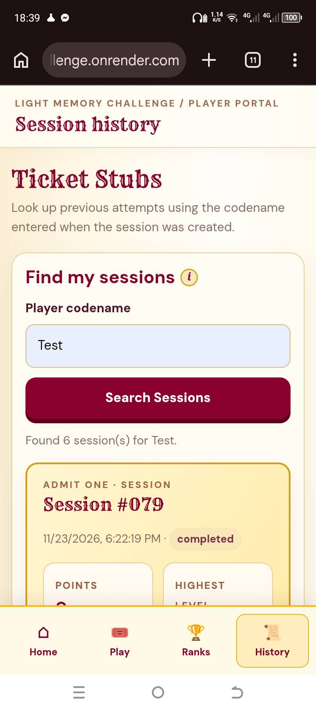

*Figure 5.4. Session history interface displaying retrieved game records.*

#### 5.5.5 Performance Analysis

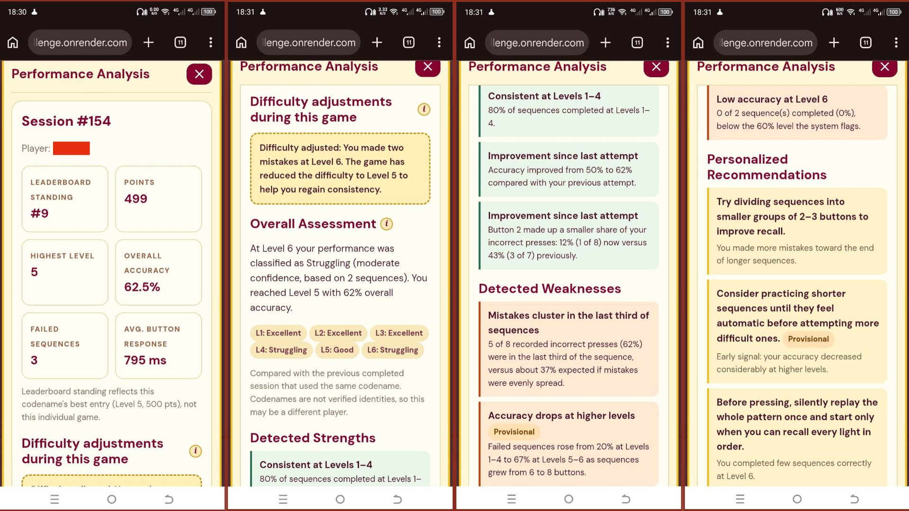

*Figure 5.5. Post-game Intelligent System analysis showing performance classifications and insights.*

#### 5.5.6 Render Deployment

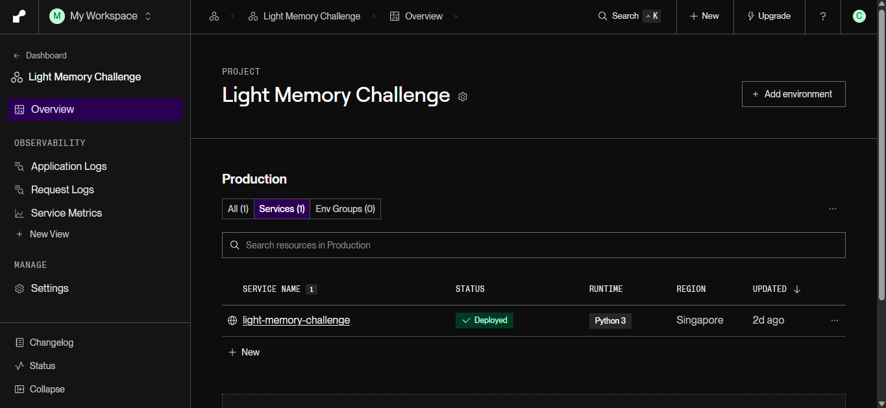

*Figure 5.6. Render service dashboard showing the deployed application.*

#### 5.5.7 Supabase Database

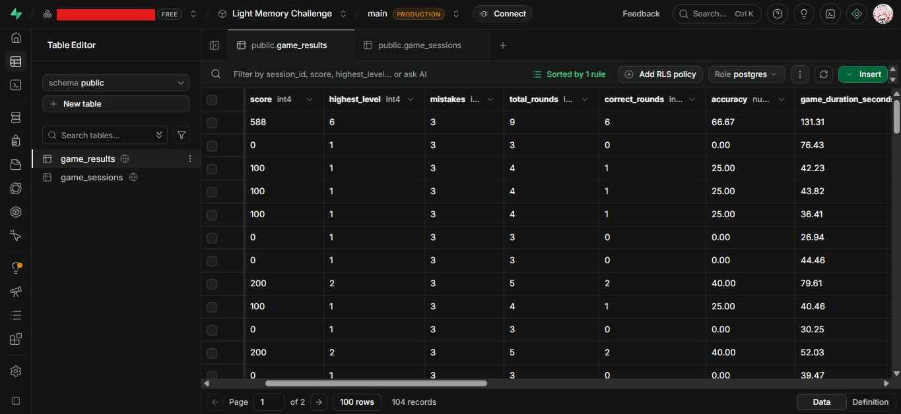

*Figure 5.7. Supabase database showing the project's relevant tables.*

### 5.6 System Demonstration

A video demonstration of the Light Memory Challenge is available through the link below. The demonstration showcases the web-based interface, gameplay mechanics, and implemented Intelligent System features, providing an overview of the system's operation from session creation to gameplay and performance feedback.

**System Demonstration Video:** [Watch on YouTube](https://www.youtube.com/watch?v=sBiUq99xk_M)

## 6. Testing Results

### 6.1 Testing Summary

The physical ESP32 prototype was tested and no wiring-related problems were encountered. The Render deployment is also operational.

During preparation of this documentation, the automated test suite included in the submitted ZIP was executed using:

```bash
python -m unittest discover -s tests -t . -v
```

**Observed result for the uploaded archive: 133 tests passed; 0 failures; 0 errors.** 

### 6.2 Automated Test Coverage

The submitted tests cover areas including:

- Difficulty-event validation and the two-mistake level reduction rule.
- Firmware/backend telemetry compatibility.
- Dashboard/backend field compatibility and JavaScript parsing.
- Intelligent System classification, confidence, response-time interpretation, and recommendations.
- Leaderboard ordering, duplicate codenames, and abandoned-session exclusion.
- Database retry behavior, error classification, health checks, and session-creation reliability.

### 6.3 Manual Test Record

Manual testing was conducted during the IoT exhibit, where approximately 20 or more participants interacted with the prototype. The hardware, gameplay, session integration, display, and web application operated as expected, with no major operational or wiring-related issues encountered. The following table summarizes the observed results.

| ID | Test category | Test procedure | Expected result | Current evidence/status |
|---|---|---|---|---|
| M1 | Hardware | Power the ESP32 and inspect the physical connections | Board starts without wiring-related fault | Passed. The physical ESP32 prototype operated during the IoT exhibit without observed wiring-related problems. |
| M2 | Functional | Observe an LED sequence and repeat it using the seven buttons | Input is detected and game feedback is correct | Passed. Players were able to observe LED sequences and reproduce them using the physical buttons during gameplay. |
| M3 | Functional | Press an incorrect button or allow a response timeout | A life is deducted and the game responds according to its rules | Passed. Incorrect inputs were handled by the game, with lives deducted according to the implemented game rules. |
| M4 | Adaptive difficulty | Make two mistakes on the same level | Firmware reduces the level by one | Passed. The in-game difficulty adjustment function operated according to the implemented rules during gameplay. |
| M5 | TFT/display | Start a session and observe countdown/game/result screens | TFT displays the corresponding game status | Passed. The TFT display provided the countdown, gameplay status, and relevant game information during operation. |
| M6 | Session integration | Create a session from the website and start it | Backend queues/schedules the session and ESP32 receives the command | Passed. Players were able to create sessions through the website and proceed to gameplay using the connected ESP32 device. |
| M7 | Cloud/database | Complete a game and inspect the saved result | Result is stored and can be retrieved from the dashboard | Passed. Completed game results were saved and made available through the web application. |
| M8 | Dashboard | Open leaderboard and session history | Data is displayed from backend responses | Passed. The dashboard's leaderboard, session history, and game result information were accessible and functioning during the exhibit. |
| M9 | Connectivity | Temporarily interrupt connectivity and restore it | Firmware retains queued results and retries delivery | Passed (observed during exhibit). Connectivity was unintentionally interrupted when the phone providing the hotspot was moved away. The result was not lost and was successfully uploaded after the hotspot connection became available again. |
| M10 | Deployment | Open the Render-hosted application and check `/api/health` | Application responds and database status is reported | Passed. The deployed web application was accessible and operational during the IoT exhibit. |
| M11 | Security | Search tracked files and commit history for secrets | No real credentials or tokens are exposed | Implemented. .env and firmware/src/arduino_secrets.h are excluded through .gitignore to prevent accidental inclusion of credentials in the repository. |

### 6.4 Issues and Resolutions

The following issues were encountered during development and addressed through firmware updates.

| Issue | Effect | Resolution / current status | Evidence |
|---|---|---|---|
| TFT countdown could become too short or skip expected countdown numbers when the ESP32 received the start command late or its clock timing was implausible. | The physical display could appear out of sync with the website countdown. | TThe firmware was updated to use an independent ESP32-side countdown, beginning at four and proceeding to GO. This approach avoids dependence on clock synchronization between the device and backend. The website and device countdowns are not synchronized exactly; the device uses a local countdown to provide a consistent pre-game sequence. | `UPDATE_NOTES.md`, sections “TFT countdown reliability fix” and “Countdown synchronization, TFT score order, and ranking consistency”; add physical test evidence. |
| Website session abandonment was not immediately recognized by the ESP32 during an active game. The device only checked for commands while idle, while gameplay was handled by a blocking function. | The physical game could continue even after the session was abandoned through the website. The ESP32 would only discover the abandonment after attempting to upload the result, which the backend rejected with a 409 response. | Added remote abandonment detection through remoteSessionAbandoned(), which checks the session status at most once every 1.5 seconds, but only at the start of each round to avoid affecting gameplay timing and player input. Added a dedicated START_ABANDONED state to handle abandonment during the countdown. Abandoned games are not uploaded or queued. The device now responds to remote abandonment at the next round boundary, or at the start of gameplay if abandonment occurs during the countdown. | Firmware commit documenting the remote session abandonment fix. The implementation and its known timing limitations are documented in the commit.

## 7. Security and Privacy Notes

### 7.1 Safeguards Implemented

- **Backend secrets:** Supabase URL and service-role key are read from environment variables rather than hard-coded in the backend source.
- **Ignored local configuration:** `.env` and `firmware/src/arduino_secrets.h` are listed in `.gitignore`; example templates are provided for setup.
- **Device authentication:** device requests include an `X-Device-Token` header checked by the backend for protected device routes.
- **Data minimization:** players use codenames rather than requiring their real names for gameplay.
- **Database access:** the backend communicates with Supabase server-side; the service-role key should never be exposed to the browser.

### 7.2 Known Security and Privacy Limitations

1. **TLS certificate verification:** the current firmware calls `secureClient.setInsecure()`. This skips server certificate verification. Although the HTTPS connection may be encrypted, the device does not validate that it is communicating with the intended server. This is acceptable only as a documented classroom/demo limitation and should be replaced with certificate validation (for example, a trusted CA certificate) before production use.
2. **Shared device token:** the device token is a shared credential. Anyone who obtains it may be able to impersonate the configured device for protected routes. Keep it private and rotate it if exposed.
3. **Codenames are not identities:** codenames are not unique. Anyone who knows a codename may be able to find associated session records through the search feature. Avoid real names or sensitive information.
4. **Free hosting constraints:** availability, sleep/cold-start behavior, and resource limits depend on the hosting provider's current Free-plan policies. Do not treat the free deployment as a guaranteed production service.
5. **Repository history:** removing a secret from the latest file does not remove it from earlier Git commits. If a credential was committed, rotate it and review repository history.

### 7.3 Privacy Considerations

The system stores codenames and gameplay/session information. The project should collect only the information required for the game and its performance feedback. Screenshots used for academic documentation should avoid exposing private credentials, real personal information, or unrelated user data.

## 8. Setup and Usage Instructions

### 8.1 Backend Setup (Local)

1. Install Python and Git.
2. Clone the project repository and open a terminal in the repository root.
3. Create and activate a virtual environment.
4. Install dependencies using `pip install -r backend/requirements.txt`.
5. Copy `.env.example` to `.env` and configure the Supabase URL, service-role key, and device token.
6. Apply `database/schema.sql` to the Supabase project. Apply the readable session ID migration if it has not already been applied.
7. Start the backend:

   ```bash
   python -m uvicorn backend.main:app --host 0.0.0.0 --port 8000
   ```

8. Open `http://127.0.0.1:8000` in a browser.

### 8.2 ESP32 Firmware Setup

1. Install Arduino IDE and the ESP32 board package.
2. Install the **Adafruit GFX** and **Adafruit ST7735 and ST7789** libraries through the Arduino Library Manager.
3. Open `firmware/src/arduino_secrets.example.h` and create a local copy named `arduino_secrets.h` in the same directory.
4. Enter the Wi-Fi SSID/password, backend base URL, device ID, and matching device API token.
5. Confirm the physical wiring against the pin assignment table and the actual prototype wiring diagram.
6. Select the correct ESP32 board and COM/serial port.
7. Open `firmware/src/LightMemoryChallenge.ino`, compile, and upload the firmware.
8. Open the Serial Monitor when troubleshooting device connectivity or firmware messages.

### 8.3 Player Usage

1. Open the deployed web application or the locally hosted dashboard.
2. Navigate to the session/game page.
3. Enter a codename and create a session.
4. Wait for the session queue/status to indicate that the turn can begin.
5. Start the game using the website. The ESP32 receives the scheduled start command and displays its countdown.
6. Watch the LED sequence and repeat it using the corresponding physical buttons.
7. Review the score and performance information on the TFT and web dashboard after the game.
8. Use the leaderboard or session-history page to review available records.
9. To abandon an active session, press the Abandon Session button on the phone screen.

### 8.4 Running Automated Tests

From the repository root, run:

```bash
python -m unittest discover -s tests -t . -v
```

### 8.5 Troubleshooting

| Problem | Checks |
|---|---|
| Backend reports Supabase is not configured | Confirm `.env` is in the repository root and required variables are set in the correct environment |
| Device reports an authentication error | Confirm `SECRET_DEVICE_TOKEN` matches backend `DEVICE_API_TOKEN` and the device ID matches the configured ID |
| Device cannot reach backend | Confirm Wi-Fi connection, backend URL, network access, and that the deployed service is responding |
| Dashboard cannot load data | Check `/api/health`, backend logs, Supabase connectivity, and the browser network console |
| Session number is missing | Confirm the readable session ID migration has been applied where required |
| TFT or button behavior differs | Recheck GPIO assignments, board variant, wiring, and installed display libraries |
| Result is not immediately visible | Check device serial output, backend logs, and the ESP32's pending result queue; a temporary network or host cold-start delay may occur |